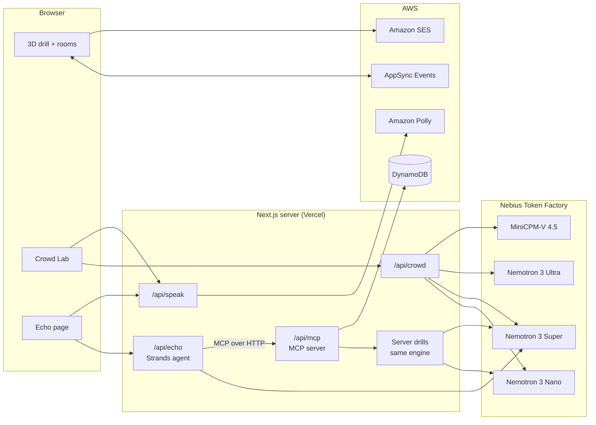

# CampusEvac

**Find out who your evacuation plan leaves behind, before a real fire does.**

CampusEvac is a fire-evacuation simulator for a school or campus building. You can play a drill yourself or watch AI people try to get out. You can also ask a voice assistant how to get out, or what would happen if a fire started somewhere.

Fire evacuation plans are written for an average person who hears the alarm, reads the signs and walks to the nearest exit. The people they fail are predictable: wheelchair users sent to a stepped exit, deaf people who never hear the alarm or the warden, people who freeze in panic, visitors who only know the door they came in by. CampusEvac makes those failures visible and measurable, and shows which changes to the building actually fix them.

> CampusEvac is a training and planning tool. In a real fire, follow the building's alarm and staff, and call your local emergency number.

## What's inside

| Part | What it is | Where |
| --- | --- | --- |
| **Fire drill** | A first-person 3D drill through the campus: six objectives (emergency backpack, lab access card, gas valve...) and then the exit, with smoke spreading and a narrated briefing. | `/simulation/play` |
| **Drill rooms** | The same drill for two people over the internet. One is the evacuee inside; the other is the warden, who sees the hazards from the cameras and talks them out. | `/simulation/rooms` |
| **Crowd Lab** | Twelve AI people, each a Nemotron agent that knows only its own room, the signs and the announcements, evacuate while an AI warden watches the CCTV and directs them over the PA. Includes a building audit, a scorecard against the six ways people die in fires, fixes to test, a floor designer, and replays. | `/simulation/crowd` |
| **Self-improving warden** | After each drill, Nemotron Ultra reviews the whole log and rewrites the warden's standing orders. The next drill's warden follows them, and a learning curve tracks whether it gets better. | Crowd Lab, **Train** |
| **MCP server** | The building as an MCP server (protocol `2025-11-25`, Streamable HTTP): routes out, smoke forecasts, whole-building plans, personal evacuation plans, and drills you can run and compare by voice. | `/api/mcp` |
| **Echo page** | A simulated Alexa+ device. Speak to it; a Strands agent running Nemotron answers by calling the MCP server, and Amazon Polly speaks the answer. | `/echo` |

## How it works



### The AI people and the warden

Each person in the Crowd Lab is an agent with a persona: a calm student, a lecturer who trusts their eyes over announcements, a wheelchair user, a deaf student, someone who panics, an elderly visitor with a cane, someone wearing headphones. Every decision they make is a real Nemotron call on only what that person can perceive from where they stand: the room they're in, the doorways and signs they can see (unless smoke hides them), the people around them, and the announcements they have heard (with their hearing delay, or not at all if deaf). They have no map.

The warden sees the building through a rendered top-down CCTV frame. A vision model reads it, and Nemotron Super decides what to announce and whom to direct by name. Their actual routes come from A* search over a walking grid read off the building's physics colliders, so people walk around the lab benches the way a person would.

## How we use NVIDIA Nemotron on Nebius Token Factory

Every model call goes through Token Factory's OpenAI-compatible API, with the key kept on the server ([app/api/crowd/nebius.ts](app/api/crowd/nebius.ts), model settings in [app/simulation/crowd/prompts.ts](app/simulation/crowd/prompts.ts)).

| Job | Model | Why this model |
| --- | --- | --- |
| Each evacuee's next move | **Nemotron 3 Nano** (30B-A3B), thinking off | Many small calls, one per person per decision. A person in a fire acts on instinct, so it answers in about two seconds for a fraction of the tokens. |
| The warden's judgement | **Nemotron 3 Super** (120B-A12B) | Reads the plan, the camera report, the roll call and its own earlier orders, then reasons about who to direct where. Falls back to a straight answer if it thinks through its whole budget. |
| The Echo voice agent | **Nemotron 3 Super**, thinking off | Picks and chains MCP tools fast enough for a voice turn: about 2 seconds per answer, including the tool call. |
| Drill review and the learned playbook | **Nemotron 3 Ultra** (550B-A55B) | One careful read of a whole drill log: what worked, who the plan failed, and a rewritten playbook of at most six general rules. |
| Building-fix advisor | **Nemotron 3 Ultra** | Reads a full building audit and decides which fix to test. |
| The warden's eyes | MiniCPM-V 4.5 | None of the Nemotron models on Token Factory take images, so the camera frame is read by a vision model and everything after that is Nemotron. |

A six-person drill run over MCP took 47 model calls and cost about **$0.02**. Each run stops spending at $0.50 regardless.

## How we use AWS

| Service | Used for |
| --- | --- |
| **Strands Agents SDK** | The Echo page's agent ([app/api/echo/route.ts](app/api/echo/route.ts)): an `Agent` with an `McpClient` connected to our own MCP server over Streamable HTTP, running Nemotron through Strands' OpenAI-compatible provider. |
| **Amazon Polly** | The warden's PA voice and the narrator in the Crowd Lab, the Echo page's voice, and the pre-rendered briefing audio in `public/voice` ([scripts/synth-voice.mts](scripts/synth-voice.mts)). |
| **AWS AppSync Events** | Realtime pub/sub for two-player drill rooms: lobby, warden commands and position updates. |
| **Amazon DynamoDB** | The drill event log, the shared warden playbook and its learning curve, drill replays, MCP drill results and occupant profiles. |
| **Amazon SES** | Emailing a participant their drill report, after they verify their address. |
| **AWS CDK** | The AppSync API and DynamoDB table ([infra/](infra/)). |

## Alexa+: the MCP server

`/api/mcp` is an [MCP](https://modelcontextprotocol.io) server (protocol `2025-11-25`, Streamable HTTP) that lets Alexa+ or any MCP client ask the building two kinds of question:

- **"Which way out?"**, for the person in the building: spoken directions that fit them.
- **"What if?"**, for the person responsible for the building: run a real Crowd Lab drill (Nemotron evacuees and an AI warden) by voice, and rerun it with fixes to see what they change.

It is stateless: each request is a POST with a JSON reply, so it runs on Vercel unchanged.

### Which way out

| Tool | What it does |
| --- | --- |
| `describe_building` | Rooms, fire exits (and which are step-free), fire scenarios |
| `find_way_out` | Spoken directions out of a room, avoiding the fire and choking smoke, or shelter-in-place advice when cut off. Name a registered person and the route fits them. |
| `register_occupant` / `forget_occupant` | Save or delete a person's first name, usual room and needs (wheelchair, deaf, blind, elderly...), like a Personal Emergency Evacuation Plan |
| `smoke_forecast` | How smoky each room is N seconds after a fire starts |
| `plan_evacuation` | Which exit each occupied room should use, load-balanced across the safe exits, a PA announcement, and every registered person's own plan |
| `list_safety_fixes` | The building fixes the simulator models (ramp, strobes, text alerts...) |
| `get_warden_playbook` | The standing orders the AI warden learned from training drills |

Routes use the lab's own room graph and smoke model ([app/mcp/evac.ts](app/mcp/evac.ts)), so an answer here matches what the simulator counts as safe. Personal routes ([app/mcp/occupants.ts](app/mcp/occupants.ts)) are step-free for a wheelchair, give doorways to count to someone who cannot see the signs, and flag the words to be shown on a screen for someone who cannot hear them.

### What if

| Tool | What it does |
| --- | --- |
| `start_drill` | Start a drill: a fire in a room, 4 to 12 AI people (always including at-risk people), an AI warden or none, optional fixes. Returns a drill id at once. |
| `get_drill_result` | How it went: who got out, sheltered or collapsed, how long it took, and who the plan let down and why. No id means the most recent drill. |
| `compare_fixes` | Rerun a finished drill with fixes, same fire, same people in the same places, and say what changed. No id means the most recent drill. |
| `run_drill` | `start_drill` as an **MCP Task** (`taskSupport: required`): returns a task, poll `tasks/get`, fetch `tasks/result` |

Drills run on the server with the same engine as the browser ([app/mcp/drills.ts](app/mcp/drills.ts)). Two things differ, because the server has no 3D scene:

- The warden reads the building's sensors (smoke detectors and occupancy) instead of a camera frame.
- People walk a map built from the wall plan ([app/simulation/crowd/walls.ts](app/simulation/crowd/walls.ts)), not from the 3D colliders, so they walk across rooms without going round the furniture.

A drill takes up to four minutes in real time. The server runs one at a time, at most `MCP_DRILLS_PER_HOUR` an hour (default 6). If `MCP_DRILL_KEY` is set, only callers sending `Authorization: Bearer <key>` can start one. Drill records and occupant profiles are kept in memory and, when AWS is reachable, in DynamoDB, so any server instance can answer about them.

### The Echo page: a simulated Alexa+

[`/echo`](app/echo/EchoClient.tsx) is an Alexa+ experience in the browser, for the hackathon's simulated-Alexa+ path:

1. **Voice in:** the browser's speech recognition (Chrome or Edge), or type.
2. **Agent:** a [Strands Agents](https://strandsagents.com) agent running **NVIDIA Nemotron 3 Super on Nebius Token Factory** ([app/api/echo/route.ts](app/api/echo/route.ts)) connects to this app's own `/api/mcp` over Streamable HTTP with Strands' `McpClient`, exactly as Alexa+ would call a brand's MCP server. Everything it can do comes from the MCP tools above.
3. **Voice out:** **Amazon Polly** (`/api/speak`, voice `assistant`), falling back to the browser's own voice if Polly is unreachable.

The ring behaves like an Echo's: blue while listening, a spinning arc while thinking, a pulse while speaking, and yellow with a chime when a drill you started has finished. Each answer shows which MCP tools it used, and answers meant for a deaf user are flagged on the Echo Show screen.

A conversation it handles end to end:

> **You:** What happens if a fire starts in the library?<br>
> **Alexa:** The drill has started. The light will turn yellow when it's done. *(start_drill)*<br>
> **You:** How did the drill go?<br>
> **Alexa:** Seven of eight people escaped in about a minute; one stayed inside. The deaf person didn't hear the alarm until late... *(get_drill_result)*<br>
> **You:** Would flashing fire alarms help?<br>
> **Alexa:** I've started a drill with flashing alarms added... *(compare_fixes)*<br>
> **You:** So, did they help?<br>
> **Alexa:** Yes. All eight got out this time, and the average escape dropped from 61 to 34 seconds... *(get_drill_result)*

## Run it yourself

### You need

- **Node.js 22 or newer** (the Strands SDK requires it).
- A **Nebius Token Factory** API key from [tokenfactory.nebius.com](https://tokenfactory.nebius.com). This is the only thing the AI parts need.
- *Optional:* an **AWS account**, for Polly voices, drill rooms, emailed reports and the shared warden playbook. Without it, those parts fall back or switch off (see below), and everything else works.

### Steps

```bash
npm ci
```

```bash
cp .env.example .env.local
```

Open `.env.local` and set `NEBIUS_API_KEY`. Then:

```bash
npm run dev
```

Open [http://localhost:3000](http://localhost:3000). The pages:

- `/simulation/crowd`: the Crowd Lab. Pick **Watch it happen** for a twelve-person drill.
- `/echo`: the simulated Alexa+.
- `/simulation/play`: the first-person drill, on your own.
- `/simulation/rooms`: two-player drill rooms. Open a room, then open its link in a second tab (or send it to a friend); the drill starts once both seats are filled.

To try the MCP server with any client:

```bash
npx @modelcontextprotocol/inspector
```

Pick **Streamable HTTP** and connect to `http://localhost:3000/api/mcp`.

### AWS (optional)

Deploy the realtime API and table with CDK, then write their addresses into `.env.local`:

```bash
npm run infra:install
```

```bash
npm run infra:deploy
```

```bash
npm run env:pull
```

For the server's own AWS calls (Polly, DynamoDB, SES), sign in with the AWS CLI locally, or on Vercel give it an IAM user with [infra/runtime-policy.json](infra/runtime-policy.json) and set `AWS_ACCESS_KEY_ID` and `AWS_SECRET_ACCESS_KEY`.

What happens without AWS:

| Without | What you get instead |
| --- | --- |
| Polly | The browser's own voice reads the warden, the narrator and the Echo page's answers. The briefing audio is pre-rendered, so it always plays. |
| AppSync | Drill rooms cannot connect (set the `NEXT_PUBLIC_EVENTS_*` addresses with `npm run env:pull`). The solo drill, the Crowd Lab and the Echo page all work. |
| DynamoDB | The warden playbook is kept in your browser only. MCP drills and occupant profiles are kept in the server's memory until it restarts. |
| SES | Drill reports are not emailed. |

### Settings

All in [.env.example](.env.example):

| Variable | What it does |
| --- | --- |
| `NEBIUS_API_KEY` | Token Factory key: the Crowd Lab, MCP drills and the Echo agent |
| `ECHO_MODEL_ID` | The Echo agent's model (default `nvidia/nemotron-3-super-120b-a12b`) |
| `WARDEN_ADMIN_KEY` | Password for training the shared warden playbook; empty lets anyone train |
| `MCP_ALLOWED_ORIGINS` | Browser origins allowed to call `/api/mcp` directly. Server-to-server clients like Alexa+ are always let in. |
| `MCP_DRILL_KEY` | When set, starting an MCP drill needs `Authorization: Bearer <key>` |
| `MCP_DRILLS_PER_HOUR` | Cap on MCP drills per hour (default 6) |
| `AWS_REGION`, `POLLY_REGION`, `SES_REGION`, `REPORTS_TABLE`, `REPORT_FROM_EMAIL` | AWS settings, see above |
| `NEXT_PUBLIC_EVENTS_*` | AppSync Events addresses, written by `npm run env:pull` |

### Checks

```bash
npm test -- app/mcp/*.test.ts app/simulation/crowd/*.test.ts
```

```bash
npm run typecheck
```

```bash
npm run lint
```

The tests never start a drill or write to DynamoDB, so they cost nothing.

## For the judges

### Nebius × NVIDIA Global AI Hackathon

- **Track:** Best Apps and Agents.
- **NVIDIA models on Token Factory:** Nemotron 3 Nano, Super and Ultra, each matched to the size of its job (see [the table above](#how-we-use-nvidia-nemotron-on-nebius-token-factory)). Hundreds of small Nano calls make up the crowd, Super does the warden's reasoning and the voice agent's tool use, and Ultra does the slow, careful review that teaches the warden.

### Build, Ship, Shape: Amazon Developer Hackathon

- **Track:** Alexa+, both ways in: a self-hosted MCP server (protocol `2025-11-25`, Streamable HTTP, including MCP Tasks) in [app/mcp/](app/mcp/) and [app/api/mcp/route.ts](app/api/mcp/route.ts), and a simulated Alexa+ experience at `/echo` whose agent calls that server.
- **AWS Builder:** the Strands Agents SDK, Polly, AppSync Events, DynamoDB, SES and CDK, as listed in [How we use AWS](#how-we-use-aws).

### Built during the submission period

Both submission periods opened in late August 2026 (Nebius: 26 August; Amazon: 31 August). All of CampusEvac was built after that, from 2 October 2026, as the git history shows: the 3D drill and rooms, the Crowd Lab and its self-improving warden, the MCP server with server-side drills and occupant profiles, and the Echo page.

## Feedback on the tools

What we found while building, for the feedback fields:

- **Nebius Token Factory:** the OpenAI-compatible API meant one small module served every model, and Strands' OpenAI provider worked with it unchanged. Turning thinking off per call (`chat_template_kwargs.enable_thinking`) is what made Nemotron usable for both a crowd of fast decisions and a voice turn. Larger reasoning models sometimes spend their whole token budget thinking; we retry those with thinking off. A Nemotron model that accepts images would let the warden's eyes be Nemotron too.
- **NVIDIA Nemotron 3:** Nano with thinking off answers in about two seconds. Super chained MCP tool calls on its own (looking up the list of fixes, then rerunning the drill with the right one). It needed explicit rules not to announce an action without calling the tool, and to call `compare_fixes` without first asking permission.
- **MCP 2025-11-25:** the TypeScript SDK's Web-standard Streamable HTTP transport dropped straight into a Next.js route. Tasks work in stateless mode only with a task store that every request can read, so we wrote one backed by our drill records.
- **Strands Agents SDK:** `McpClient` with a Streamable HTTP transport plus tool filters (to hide the Task-only tool from a voice agent) took a few lines of code.

## License

[MIT](LICENSE). Copyright 2026 Akshay R, Abhishek M S and Afreen Hossain, the CampusEvac team.
